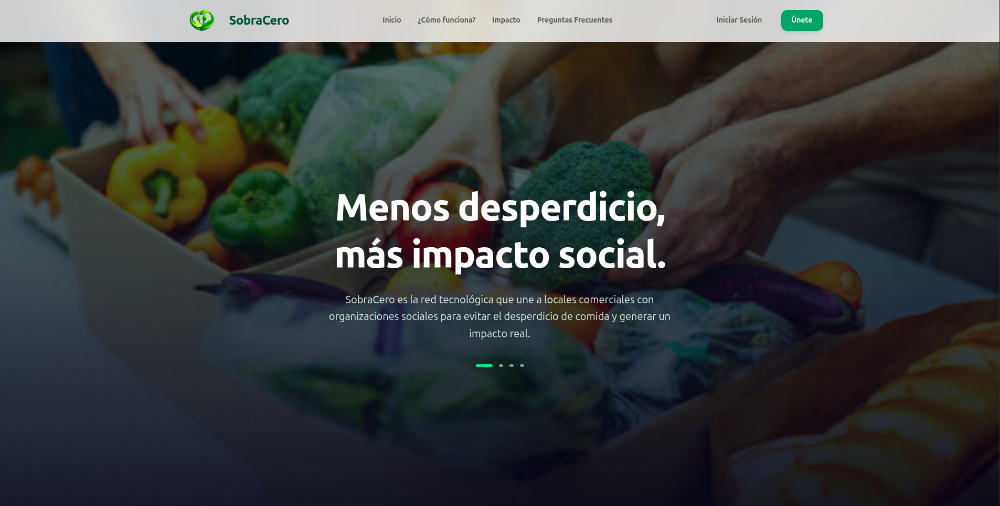

# 🌱 Sobra Cero — Frontend

> Plataforma web para la reducción del desperdicio alimentario, conectando **Donantes** (supermercados, restaurantes) con **ONGs** que distribuyen alimentos a quienes más lo necesitan.




---

## 📖 Descripción del Proyecto

**Sobra Cero** es una aplicación web desarrollada como MVP para facilitar la donación de alimentos próximos a vencer o en sobre-stock. El sistema permite a los donantes publicar sus excedentes y a las ONGs explorarlos, reservarlos y retirarlos de forma organizada.

El frontend está desarrollado en **Vue 3** con **TypeScript**, utilizando **Vite** como bundler y **TailwindCSS** para el diseño. Cuenta con un mapa interactivo (Leaflet), sistema de autenticación con JWT y roles diferenciados por tipo de usuario.

---

## ✨ Funcionalidades Principales

| Rol | Funcionalidades |
|---|---|
| **Donante** | Registrar cuenta, publicar donaciones con fotos y fecha de caducidad, gestionar el estado de sus donaciones (Disponible → Reservado → Retirado) |
| **ONG** | Explorar donaciones disponibles en mapa o lista, reservar donaciones para retiro |
| **Administrador** | Panel de gestión centralizada de usuarios y métricas del sistema |
| **General** | Registro / Login con roles, recuperación y restablecimiento de contraseña |

---

## 🛠️ Stack Tecnológico

| Tecnología | Versión | Uso |
|---|---|---|
| [Vue 3](https://vuejs.org/) | `^3.5` | Framework principal (Composition API) |
| [TypeScript](https://www.typescriptlang.org/) | `~6.0` | Tipado estático |
| [Vite](https://vite.dev/) | `^8.0` | Bundler y dev server |
| [Vue Router](https://router.vuejs.org/) | `^5.0` | Enrutamiento SPA |
| [TailwindCSS](https://tailwindcss.com/) | `^4.3` | Estilos y diseño responsivo |
| [Leaflet](https://leafletjs.com/) | `^1.9` | Mapas interactivos geolocalizados |
| [Lucide Vue Next](https://lucide.dev/) | `^1.0` | Iconografía |
| [SweetAlert2](https://sweetalert2.github.io/) | `^11` | Alertas y modales |
| [Vitest](https://vitest.dev/) | `^4.1` | Testing unitario de componentes |
| Docker + Nginx | — | Contenedorización y despliegue |

---

## 📁 Estructura del Proyecto

```
src/
├── components/
│   ├── admin/       # Componentes del panel de administración
│   ├── common/      # Componentes compartidos (modales, etc.)
│   ├── donante/     # Componentes del dashboard del donante
│   ├── ong/         # Componentes del dashboard de la ONG
│   ├── layout/      # Layout principal (navbar, sidebar, etc.)
│   └── ui/          # Componentes UI reutilizables
├── composables/     # Lógica reutilizable con Composition API
├── router/          # Configuración de rutas y guards
├── services/        # Llamadas a la API REST del backend
├── types/           # Interfaces y tipos TypeScript
└── views/           # Páginas de la aplicación
    ├── Landing.vue
    ├── Login.vue
    ├── Registro.vue
    ├── DashboardDonante.vue
    ├── DashboardOng.vue
    ├── DashboardAdmin.vue
    ├── RecuperarPassword.vue
    ├── RestablecerPassword.vue
    └── CambiarPasswordObligatorio.vue
```

---

## 🚀 Instalación y Ejecución Local

### Requisitos previos
- **Node.js** `^20.19.0` o `>=22.12.0`
- **npm**

### 1. Clonar el repositorio

```sh
git clone https://github.com/SobraCero/Frontend-Sobracero.git
cd Frontend-Sobracero
```

### 2. Instalar dependencias

```sh
npm install
```

### 3. Levantar el entorno de desarrollo

```sh
npm run dev
```

La app estará disponible en `http://localhost:5173` (o el puerto que asigne Vite).

### 4. Build para producción

```sh
npm run build
```

### 5. Ejecutar tests

```sh
npx vitest run
```

---

## 🐳 Despliegue con Docker

El proyecto incluye un **Dockerfile multi-stage** que:
1. Compila la app con Node.js 22 Alpine.
2. Sirve el bundle estático con **Nginx Alpine** en el puerto `80`.

```sh
# Construir la imagen
docker build -t frontend-sobracero .

# Ejecutar el contenedor
docker run -p 80:80 frontend-sobracero
```

---

## 🏗️ Arquitectura

El sistema sigue una arquitectura **Cliente-Servidor** con separación total de frontend y backend:

- **Frontend (este repo):** SPA en Vue 3, desplegada de forma estática vía Nginx.
- **Backend:** API RESTful en Java 17 + Spring Boot 3, con seguridad JWT y persistencia en PostgreSQL.
- **Almacenamiento de archivos:** MinIO (compatible con S3) para imágenes de donaciones.
- **Infraestructura:** Docker Compose para orquestación; AWS EC2 + Nginx como proxy inverso para producción.

---

## 🔒 Seguridad

- Autenticación con **JWT** gestionado en el cliente.
- Rutas protegidas por **guards de Vue Router** según el rol del usuario.
- Contraseñas encriptadas con **BCrypt** en el backend.
- Configuración de **CORS** en la API.

---

## 🗺️ Aspectos Destacables

- 📍 **Mapa interactivo** con Leaflet para visualizar y filtrar donaciones geolocalizadas.
- 🖼️ **Almacenamiento S3** (MinIO) para imágenes, evitando guardar blobs en la base de datos.
- 🎨 **Interfaz premium** — animada, responsiva y con experiencia de usuario cuidada.
- 🔄 **Flujo de estados de donaciones** (Disponible → Reservado → Retirado) gestionado desde ambos dashboards.

---

## ⚙️ IDE Recomendado

[VS Code](https://code.visualstudio.com/) con la extensión [Vue (Official)](https://marketplace.visualstudio.com/items?itemName=Vue.volar).

Para devtools en el navegador:
- **Chrome/Edge/Brave:** [Vue.js devtools](https://chromewebstore.google.com/detail/vuejs-devtools/nhdogjmejiglipccpnnnanhbledajbpd)
- **Firefox:** [Vue.js devtools](https://addons.mozilla.org/en-US/firefox/addon/vue-js-devtools/)

---

## 📝 Licencia

Proyecto académico — Arquitectura de Software.
